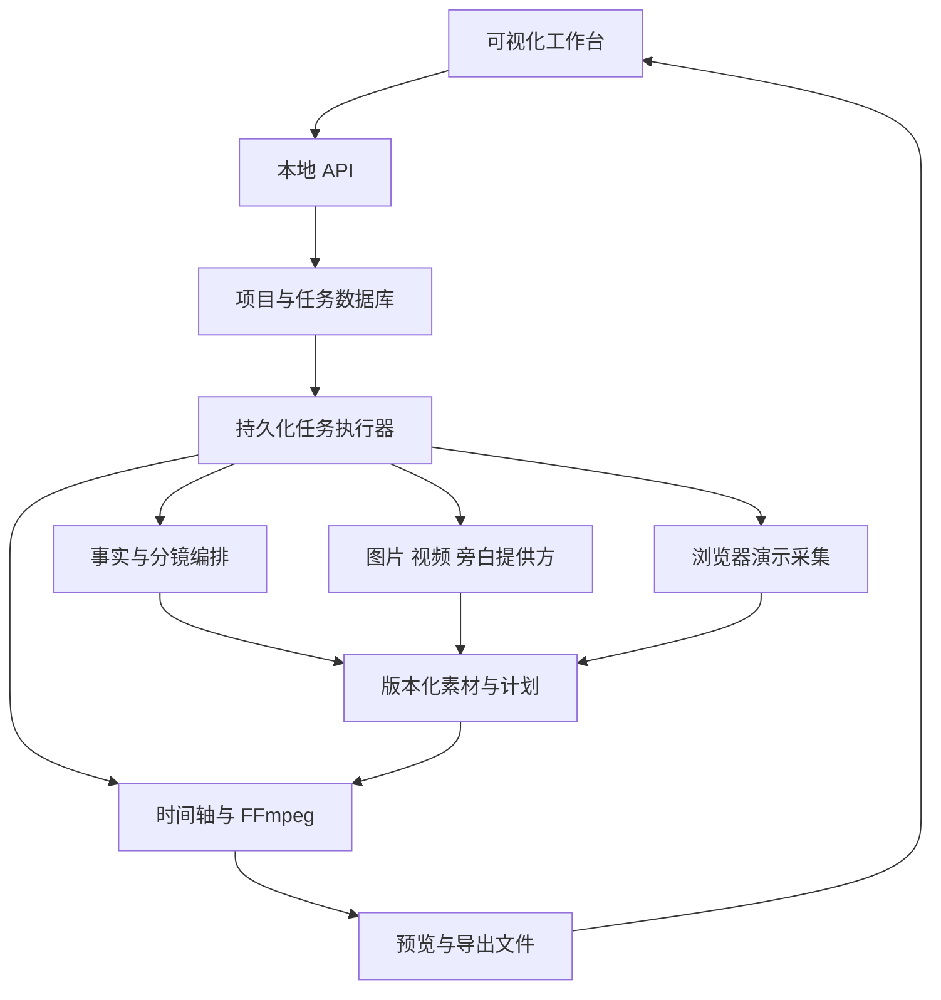

# 技术架构

状态：v0.1 提议设计，未实现。需求以 [PRODUCT_REQUIREMENTS](PRODUCT_REQUIREMENTS.md)、字段以 [DATA_MODEL](DATA_MODEL.md) 为准。依据和静态核查范围见 [REFERENCES](REFERENCES.md)。

## 1. 架构目标

面向单用户的本地视频工作台，将内容规划、镜头生成、真实演示和剪辑调度分开。每个部分能独立验证；用户修改一个镜头后，不重新生成没有受影响的素材。后台任务可以恢复，界面能解释当前结果与下一步。

初版运行于用户 Mac mini / MacBook 的本地环境，正式首验以 macOS Apple Silicon 为准。UI 与 API 默认同源 `http://127.0.0.1:4317`。远程访问、公开部署和多用户鉴权不在默认范围。

## 2. 模块与责任

| 模块 | 输入 / 输出 | 不负责的内容 |
| --- | --- | --- |
| Source ingestion | 项目材料 → SourceDocument / ProductFact | 执行输入仓库任意脚本 |
| Planner | 已核实产品事实、模板 → Section / Shot / 演示建议 | 自动假设未证实功能存在 |
| Provider adapters | 结构化请求 → 可验证 Asset / ProviderOperation | 修改全局时间轴或暗换模型 |
| Demo runner | 接受的 DemoScenario → DemoRun + 录制素材 | 猜测授权、执行未接受的新步骤 |
| Timeline compiler | 已就绪素材、剪辑选择 → 冻结 RenderPlan | 任意变速产品原声或补造结果 |
| Renderer | 冻结计划 → 预览 / 导出 + 检查报告 | 重新规划文案和镜头 |
| Job service | 持久化任务、租约、状态事件 | 以进程内变量作为唯一真相 |

## 3. 技术栈与选择边界

| 部分 | 默认选择 | 实施时要求 |
| --- | --- | --- |
| 前端 | React + TypeScript + Vite | 使用共享契约；实际界面必须可测试 |
| API | Fastify + TypeScript | Schema 校验、请求版本检查、结构化错误 |
| 数据 | SQLite，WAL 模式 | 迁移、事务、busy timeout；在 Mac 上验证驱动安装 |
| 任务 | SQLite 持久化队列 + 独立 Node worker | 单个本地调度器；按资源限并发 |
| 浏览器 | Playwright + full Google Chrome / 已验证 full Chromium | 不把 headless shell 作为带音频采集的默认实现 |
| 媒体 | FFmpeg / ffprobe 外部可执行文件 | doctor 核对编码器、字幕、混音功能及实际路径 |
| 模型 | Codex 适配器、Google Omni 适配器、可替换 TTS | 按本机官方能力探测结果接入 |
| 工程 | pnpm workspace，锁文件 | T00 固定兼容的受支持 Node LTS、pnpm 与依赖版本 |

不凭文档猜测最新版本，不使用无锁定的 `latest` 安装来证明可重现。原生桌面壳、Remotion、OBS 是经过具体问题验证后再引入的候选，不是预装要求。依赖复用须记录精确版本、许可证与借用位置；“参考架构”不等于已经选择整仓 fork。

## 4. 建议目录

| 路径 | 职责 |
| --- | --- |
| `apps/web/` | 页面、编辑表单、分镜卡片、预览、任务状态 |
| `apps/server/` | 本地 API、静态服务、媒体授权读取 |
| `apps/worker/` | 作业租约、调度、取消、恢复 |
| `packages/contracts/` | Schema、共享类型、ID、错误码、版本 |
| `packages/domain/` | 事实、章节、版本失效、预算、时间轴规则 |
| `packages/providers/` | Codex / Omni / TTS / 测试适配器 |
| `packages/capture/` | 演示步骤、录制、事件时钟、原声检查 |
| `packages/render/` | 计划编译、FFmpeg 参数、探测与验证 |
| `packages/storage/` | SQLite 仓储、迁移、素材原子写入 |
| `fixtures/demo-product/` | 可重置的本地演示测试产品，提供画面/声音校准 |
| `tests/integration/`、`tests/e2e/` | 有意义的集成与用户流程检查 |
| `docs/`、`examples/` | 规格、决策、任务、示例 |

不要在首日为空目录造大量抽象。T01 只建立第一条垂直流程需要的模块，其余随任务引入。

## 5. 本地数据布局

由 `PRODUCTFILM_DATA_DIR` 指向，缺省使用本机应用数据目录。Mac 推荐 `~/Library/Application Support/ProductFilm/`；在测试环境必须另设临时目录。仓库、数据、浏览器登录资料分离。

| 相对数据路径 | 内容 |
| --- | --- |
| `db/productfilm.sqlite` | 元数据、版本、任务、事件 |
| `projects/<projectId>/sources/` | 只读材料快照、仓库 commit 信息 |
| `projects/<projectId>/assets/<assetId>/<revision>/` | 原始与派生素材、probe.json、sha256 |
| `projects/<projectId>/scenarios/` | 接受的步骤快照 |
| `projects/<projectId>/timelines/` | 不可变计划与编译报告 |
| `projects/<projectId>/exports/` | 预览和正式成片 |
| `jobs/<jobId>/<attemptId>/tmp/` | 每次attempt独立中间文件，验证且确认有效租约后原子发布 |
| `reports/<runId>/` | 运行环境、校准、验收证据与脱敏日志 |
| `browser-profiles/<profileId>/` | 用户正常登录的专用浏览器 profile，不入导出包 |

数据库只记录受控相对路径。通过解析并校验实际路径仍在允许根目录内，阻止 `..`、符号链接越界和任意本地文件读取。备份项目默认包含引用素材与计划，可选择附带原始录制；排除凭据和 browser profile。

## 6. API 合同

API 前缀 `/api/v1`；所有写入返回新 revision。普通编辑使用 `expectedRevision`，冲突返回 409 和当前版本，不覆盖另一窗口的新修改。长任务返回 202 + `jobId`，不能在 HTTP 请求里等几分钟生成完视频。

| 方法与路径 | 行为 |
| --- | --- |
| `GET /health` | 服务/worker基本状态，不返回秘密 |
| `GET /capabilities` | 实际探测状态、版本和证据时间 |
| `PUT /settings/providers/:providerId` | 保存提供方的非秘密配置与凭据引用；秘密写入独立本地存储，不在响应中回显 |
| `POST /projects/:id/budgets` | 保存用户接受的本轮调用/费用上限，返回budgetRef |
| `POST /projects` / `GET /projects/:id` | 新建 / 获取项目快照 |
| `POST /projects/:id/sources` | 导入材料并保存来源 |
| `POST /projects/:id/plan` | 为指定 revision 排队规划，返回 Job |
| `PATCH /projects/:id/sections/:sectionId` | 更新讲稿/预算并计算依赖失效 |
| `PATCH /projects/:id/shots/:shotId` | 更新镜头/素材选择并返回受影响项 |
| `PUT /projects/:id/scenarios/:scenarioId` | 保存步骤新版本，清除旧接受标记 |
| `POST /projects/:id/scenarios/:scenarioId/approve` | 接受精确 revision 与其动作范围 |
| `POST /projects/:id/scenarios/:scenarioId/runs` | 排练/录制已接受版本 |
| `POST /projects/:id/shots/:shotId/generate` | 生成指定 revision，需运行预算 |
| `POST /projects/:id/narrations` | 保存旁白文本/语言/声音选择或已导入的音频引用 |
| `POST /projects/:id/narrations/:narrationId/generate` | 对指定旁白revision排队TTS，需budgetRef |
| `POST /projects/:id/assets/import` | 导入图片、视频、旁白或音乐，校验后保留imported来源 |
| `POST /projects/:id/timelines/compile` | 编译或返回具体时长/素材冲突 |
| `POST /projects/:id/exports` | 对冻结计划生成 preview/final |
| `GET /jobs/:id` / `POST /jobs/:id/cancel` | 查询/请求取消 |
| `POST /jobs/:id/reconcile` | 查询/核实已有远程操作，禁止创建新的付费生成 |
| `GET /projects/:id/events` | SSE，支持 Last-Event-ID 重连 |
| `GET /assets/:id/content` | 校验项目归属后提供媒体，支持 Range 请求 |

操作型 POST 接受 `Idempotency-Key`，唯一作用域为project、动作、key，并绑定requestFingerprint和输入revision。同key同内容返回已有结果，同key不同内容返回409 `idempotency_conflict`。它用于避免本地重复排队；**不能据此假定外部模型 API 也提供幂等性**。

错误统一：`{code,message,details,retryable,jobId?,currentRevision?}`。包括 `revision_conflict`、`idempotency_conflict`、`missing_provider_configuration`、`provider_capability_unverified`、`approval_revision_mismatch`、`audio_track_missing`、`expected_audio_not_detected`、`av_sync_out_of_range`、`av_sync_unverified`、`duration_conflict`、`stale_dependency`、`unknown_external_outcome`、`budget_exceeded`。不要把所有问题变为“生成失败”。

## 7. 队列、恢复与并发

任务包含输入快照、目标产物、依赖、attempt、leaseOwner、leaseExpiresAt 和取消状态。领取在事务内完成；同一任务不得有两个有效执行租约。每次attempt有递增fencing token，发布时以条件事务检查token/租约仍有效，过期worker即使恢复也不能覆盖新产物。心跳到期后先检查子进程/外部任务结果，不能马上重新执行有副作用的步骤。

默认同时进行一个真实浏览器录制和一个 FFmpeg 合成，生成任务按提供方配置的小并发执行。并发数是初始资源策略，不是经性能测试得出的最优值。正式运行前允许用户配置。

本地操作采用至少一次调度、幂等写入与校验；不宣称跨数据库、文件系统和供应商实现了“恰好一次”。外部创建请求前持久化 `dispatching`，返回后保存 operationId。若进程在返回前崩溃，进入结果未知流程，查询/人工核实后再决定下一步。

取消先阻止下游任务和新的付费提交。可终止的本地 FFmpeg/浏览器子进程先正常停止并关闭文件，超过受控超时再终止。远程支持取消才发送取消请求；未知状态保持可见。只有完成媒体验证并原子发布的 Asset 才为 ready。

## 8. 缓存与修改传播

缓存键来自规范化输入、依赖版本与哈希、提供方/模型/参数、提示模板版本、风格版本以及渲染器版本。不要仅按 shotId 或文件名缓存。

| 用户修改 | 需要失效 | 通常不需要失效 |
| --- | --- | --- |
| 旁白文字 | 该旁白、字幕对齐、受影响时间轴和导出 | 未变化的原始录屏 |
| 图片分镜 | 该图依赖的视频、对应计划和导出 | 独立演示片段 |
| 演示步骤 | 对应 DemoRun、录制、剪辑选择与导出 | 其他无依赖生成镜头 |
| 品牌字体/字幕样式 | 叠字、预览和导出 | 原始声音和录屏；生成画面若包含该样式则按显式依赖失效 |
| 旁白音量 | 混音与导出 | TTS 源音频 |

冻结导出保存完整 RenderPlan 与其资产哈希。渲染期间项目变更不会修改正在渲染的版本；UI 标出“旧版本预览”并允许另行排队最新版本。

## 9. 本地访问边界

API 绑定 `127.0.0.1`；本地安装启动时建立会话令牌并校验 Origin / Host，关闭跨站任意调用。Vite 开发端口 5173 通过受控代理访问 4317。令牌不放查询字符串或日志，不把“只在本机”误当作可接受所有来源请求。

用户给出的产品网址可为 localhost 或明确的线上域名。演示导航限制在该次接受的目标范围；登录新域名或动作范围变化须显示。不要阻断正常页面加载的全部静态资源，也不要把网址输入变成任意后端文件/网络读取器。

## 10. 运维与完成证据

结构化日志至少含 projectId、jobId、attemptId、stage、duration、result、errorCode；秘密和不必要的页面内容脱敏。日志、UI事件和验证报告共享 jobId，便于定位错误。

`doctor` 与真实验证报告必须记录 OS/架构、Node、浏览器、Playwright、FFmpeg build 和已核对的模型能力快照。不能用其他机器的成功替代首验平台的声音验证。详细验收见 [TESTING](TESTING.md) 和 [ACCEPTANCE_CRITERIA](ACCEPTANCE_CRITERIA.md)。

